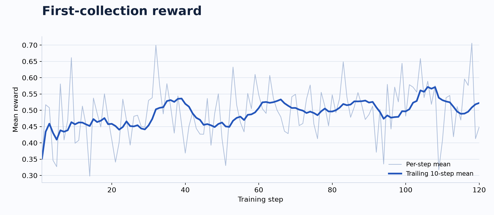

<h1 align="center">RobustOps</h1>

<p align="center">
  <strong>Open-source SFT and reinforcement learning for 4B enterprise tool agents to improve task completion and recovery from tool failures.</strong>
</p>

<p align="center">
  <a href="LICENSE"></a>
  
  <a href="https://huggingface.co/collections/haohuiliang/robustops-6ad051ea2e58c851faa61dd0"></a>
</p>

<p align="center">
  <a href="README.md">English</a> · <a href="README.zh-CN.md">简体中文</a>
</p>

<p align="center">
  <a href="#quick-start">Quick start</a> · <a href="#models">Models & data</a> · <a href="#training">Training</a> · <a href="#evaluation">Evaluation</a> · <a href="#results">Results</a>
</p>

<p align="center">
  <strong>Fault recovery training · Enterprise MCP tasks · State verification · Open models & trajectories</strong>
</p>

---

RobustOps is an open-source LLM post-training project for enterprise tool-use agents. It combines supervised fine-tuning (SFT) and agentic reinforcement learning (Agentic RL) to improve tool-use reliability, agent fault tolerance and fault recovery in multistep tasks. An update may commit without an acknowledgement, a read may be incomplete, or a reply may belong to another request. The project combines executable fault and recovery environments, teacher supervision and state-verification feedback to teach agents to adapt their decisions, check state and continue toward the requested outcome.

Tasks from [EnterpriseOps-Gym](https://github.com/ServiceNow/EnterpriseOps-Gym) cover calendar, email, cloud storage, customer service, HR, IT service management and team collaboration. Given a natural-language request, the model queries, updates and creates resources through Model Context Protocol (MCP) tools to complete multistep tasks within or across services. Final database state verifiers determine whether the task is complete.

<a id="results"></a>

## Results at a glance

The teacher model is DeepSeek-V4.1-Flash-0910. Test task success across Base → SFT → RL120, compared with the teacher model:

| Evaluation set | Base | SFT | RL120 | DeepSeek-V4.1-Flash-0910 |
|---|---:|---:|---:|---:|
| Clean: all 130 items | 15/130 (11.54%) | 28/130 (21.54%, +10.00 pp) | 40/130 (30.77%, +9.23 pp) | 46/130 (35.38%) |
| Fault: 116 common-hit items | 9/116 (7.76%) | 28/116 (24.14%, +16.38 pp) | 39/116 (33.62%, +9.48 pp) | 39/116 (33.62%) |

Gains along Base → SFT → RL120 are percentage points (pp) over the preceding stage. RL gains **19.23 pp on clean and 25.86 pp on fault** over Base. The fault row above uses the four-model common actual-hit set after supplementation. The teacher model uses the same tasks and evaluation settings, without added teacher guidance.

## Approach

The main contributions are:

- Fault environment: executable fault injection and checkpoint replay let agents learn to check uncertain outcomes and continue business tasks after tool failures.
- Teacher data: guided collection, success checks and trajectory processing turn successful teacher paths into SFT demonstrations for a student cold start.
- Training strategy: combine basic tasks with fault recovery, starting grouped continuations from the same post-fault state to compare recovery decisions from a shared boundary. Dynamically filter training samples by group-relative learning signal, then return zero-signal cases after a delay for fresh sampling under the updated policy.
- Learning signals and credit assignment: build a graph of the state checks, credit progress according to their dependencies and combine it with task success and call quality. Normalize reward components separately before weighting to reduce interference from differences in scale, then assign credit to specific action spans to discourage bad calls and repeated reads without progress, and avoid reinforcing premature termination on failed tasks. [GDPO](https://arxiv.org/abs/2601.05242)

Training builds on [veRL](https://github.com/verl-project/verl); enterprise tasks and environments come from [EnterpriseOps-Gym](https://github.com/ServiceNow/EnterpriseOps-Gym). Inference used 2 × RTX 5090 (32 GB each); SFT/RL training used 2 × RTX PRO 6000 Blackwell (96 GB each).

<a id="quick-start"></a>

## 1. Install the environment

Create the `rops` environment, then install the dependencies in [requirements.txt](requirements.txt). Run subsequent commands from the repository root.

```bash
# Get the source.
git clone https://github.com/haohuiliang/RobustOps.git
cd RobustOps

# Create and install the environment.
conda create -n rops python=3.12 -y
conda activate rops
bash scripts/setup.sh
```

<a id="models"></a>

## 2. Prepare model assets

Task splits, fault candidates, fixed fault manifests, verifier graphs and SFT data are included in the source. Download the models needed for your workflow:

### Base

The initial model is [Arctic-MidTool-RL-4B](https://huggingface.co/MidTool/Arctic-MidTool-RL-4B), a Qwen3-based 4B model already trained with tool-use SFT and agentic RL. Base refers to this checkpoint throughout this repository, before RobustOps SFT/RL. Download it for Base evaluation, SFT training and the tokenizer used by teacher evaluation.

```bash
# Download the initial Base model and tokenizer.
hf download MidTool/Arctic-MidTool-RL-4B --local-dir models/base/Arctic-MidTool-RL-4B
```

### SFT

[RobustOps-SFT-4B](https://huggingface.co/haohuiliang/RobustOps-SFT-4B) is the adopted epoch 2 / step 174 model. Its FP32 weights preserve the exported precision for evaluation and further training, including RL initialization. Evaluation loads the weights as BF16.

```bash
# Download SFT weights for inference or RL initialization.
hf download haohuiliang/RobustOps-SFT-4B --local-dir models/sft
```

### RL BF16 — recommended for inference

[RobustOps-RL-4B-BF16](https://huggingface.co/haohuiliang/RobustOps-RL-4B-BF16) contains the final step 120 weights in BF16. Use this version for RL evaluation and inference.

```bash
# Download the recommended BF16 RL inference weights.
hf download haohuiliang/RobustOps-RL-4B-BF16 --local-dir models/rl
```

### RL FP32 — optional for further training

[RobustOps-RL-4B](https://huggingface.co/haohuiliang/RobustOps-RL-4B) preserves the original exported weight precision for further training. Actual inference runs in BF16.

```bash
# Optional: download FP32 weights for further training.
hf download haohuiliang/RobustOps-RL-4B --local-dir models/rl_fp32
```

## 3. Prepare the dataset and enterprise runtime

### Task splits

Oracle exposes the task's designated tools. plus5 exposes those same tools plus five distractor tools, testing tool selection with irrelevant alternatives. The runtime retains the upstream mode key `plus_5_tools`.

| Split | Tasks | Oracle items | plus5 items | Total items |
|---|---:|---:|---:|---:|
| Train | 518 | 518 | 507 | 1,025 |
| Val | 64 | 64 | 63 | 127 |
| Test | 66 | 66 | 64 | 130 |

Cases are counted as task × tool configuration. Task IDs are split before expanding tool configurations; oracle and plus5 versions of a task never cross splits. The [Effective task manifest](data/task_sets/enterpriseops.jsonl) fixes these tasks and their partitions; [Population notes](data/task_sets/enterpriseops.json) record sources and allocation rules. For the final model, Train is used for parameter updates and Val for training decisions; Test remains unseen throughout training and is used only for final evaluation.

### Enterprise runtime

The enterprise tasks, databases and state verifiers come from [EnterpriseOps-Gym](https://github.com/ServiceNow/EnterpriseOps-Gym/tree/271f2c357f763376997dfd16807fcde2474ae41b). Prepare its seven-domain MCP runtime:

```bash
# Prepare the seven-domain MCP runtime and project adapters.
bash backends/enterpriseops/prepare_udocker.sh all
```

To avoid mistaking dataset or environment problems for model capability differences, the project adjusts four areas:

| Area | Main changes |
|---|---|
| Dataset curation | Align task descriptions, initial states and tool configurations; exclude two tasks with conflicting target definitions and one with an unobservable identity constraint. |
| Verifier consistency | Correct field, comparison and duplicate-check issues so scoring agrees with task intent and database state. |
| Tool interfaces and errors | Align tool declarations with actual interfaces, preserve error semantics and distinguish business constraints from infrastructure failures. |
| State and runtime isolation | Repair query, write and transaction behavior, keep returned evidence consistent with stored state, isolate attempts and release resources. |

See [Gym adapters](backends/enterpriseops/README.md).

### Fault types

Faults act at the tool boundary while task-success verifiers stay unchanged. Five mechanism families contain seven runtime subtypes. Counts refer to the [130-item Base-fixed Test manifest](artifacts/base_test_fixed_mechanisms.json).

| Mechanism family | Subtype / runtime label | Injection behavior | Test items |
|---|---|---|---:|
| 1. Unexecuted write | Transient rejection (`transient_unexecuted`) | Reject before dispatch; no write occurs. | 26 |
| 2. Missing information | Partial collection (`partial_read`) | Remove items while the native count exposes the omission. | 6 |
| | Truncated response (`truncated_read`) | Cut a structured read midway. | 20 |
| 3. Mismatched reply | Reply mixup (`reply_mixup`) | Attach an approved earlier response from the same server to another read. | 28 |
| 4. Uncertain commit | Unknown write status (`unknown_commit`) | Write succeeds; replace its acknowledgement with a timeout. | 10 |
| | Unknown create status (`unknown_commit_create`) | Creation succeeds; hide confirmation and generated identity. | 16 |
| 5. Ignored filter — OOD | Ignored optional predicate (`ignored_filter`) | Omit a removable filter; return a verified strict superset while preserving required scope. | 24 |

Recovery decisions include safe retry for calls known not to have executed; recovery from incomplete reads and evidence reconstruction for missing or truncated responses; response and object identity checks for reply mixups; and read-back with write-state verification after an uncertain commit to avoid duplicate writes and other duplicate side effects. These decisions support tool-call failure recovery and stateful workflow recovery, preserving completed work while continuing the remaining task.

The entire fifth family is held out of project SFT/RL; the first four are trained.

These mechanisms have counterparts in real services: Microsoft Graph [rejects throttled requests](https://learn.microsoft.com/en-us/graph/throttling); Google Drive flags [potentially incomplete search results](https://developers.google.com/workspace/drive/api/reference/rest/v3/files/list), and interrupted HTTP connections can leave [responses incomplete](https://www.rfc-editor.org/rfc/rfc9112.html#section-8); a GitHub incident involved [connection reuse mismatching requests and database responses, exposing private data](https://github.blog/news-insights/the-library/incident-report-inadvertent-private-repository-disclosure/); retrying a timed-out calendar creation can create duplicates, motivating Microsoft Graph's [deduplication identifier](https://learn.microsoft.com/en-us/graph/api/resources/event?view=graph-rest-1.0); and ServiceNow by default [ignores invalid query conditions](https://www.servicenow.com/docs/r/api-reference/rest-apis/c_TableAPI.html), potentially broadening results. These cases illustrate how agents can miss work, repeat writes or modify the wrong objects when they misjudge execution outcomes, evidence completeness or operation scope. The project abstracts these risks into reproducible tool-level injections; their exact response formats and frequencies do not represent production behavior.

### Ready-to-use teacher products

These three products were prepared with assistance from DeepSeek-V4.1-Flash-0910. Default recipes read the supplied files directly:

| Product | Supplied data | Use |
|---|---|---|
| Fault-selector results | [data/fault_selector/](data/fault_selector/) | Train/Val/Test candidate labels per task and tool, narrowing the runtime injector’s checks. [Fault injection](#fault-injection-workflow) |
| Verifier graphs | [data/verifier_graph/](data/verifier_graph/) | Dependencies between Train/Val checks for RL progress feedback. [Reward](#reward-complete-the-task-with-credit-for-valid-progress) |
| SFT demonstrations | [data/sft/](data/sft/) | 692 Train demonstrations and 15 records for quick monitoring of Val performance, in JSONL/Parquet. [SFT](#sft-1) |

To generate or collect your own, see [fault-selector scans](https://www.github.com/haohuiliang/RobustOps/blob/main/data/README.md#user-content-generate-fault-labels), [verifier graphs](https://www.github.com/haohuiliang/RobustOps/blob/main/data/README.md#user-content-generate-verifier-graphs) and [SFT demonstrations](https://www.github.com/haohuiliang/RobustOps/blob/main/data/README.md#user-content-collect-sft-demonstrations) for CLI commands, output directories and downstream use.

## 4. Run evaluation and prepare teacher data

For a quick Base / RL comparison, see the [five inference examples](examples/README.md).

### Shared execution protocol

Base tends to call tools one at a time, while the teacher more often proposes several calls in the same turn. To align teacher demonstrations and evaluation with Base's stepwise interaction, all models retain one tool call per turn (`plan_preserving`): execute the first proposed call, then infer the next action from its actual result.

Context is aligned to the student: Base/SFT/RL and teacher evaluation use the Base tokenizer and chat template to count the original task prompts, tool definitions and full assistant/tool history within 32,768 tokens. Before each request, 2,048 output tokens are reserved; if they no longer fit, the episode ends without trimming history.

Teacher-data collection counts the student-visible context after removing extra guidance. Export keeps the executed history and checks that the complete sample fits within 32K. Full collection reserves 4K output tokens per turn; evaluation and fixed cases reserve 2K. Extra teacher guidance does not consume the exported student's context.

### Fault injection workflow

1. The LLM fault selector narrows the injector’s check scope. The [selector](src/robustops/data/fault_candidates.py) uses tasks, tool schemas and native response shapes to propose applicable tool–fault combinations offline. During clean rollouts, the runtime injector checks only these candidates rather than every tool against every fault mechanism; actual calls, responses and state determine eligibility. [Supplied scans](data/fault_selector/) · [Generate scans](https://www.github.com/haohuiliang/RobustOps/blob/main/data/README.md#user-content-generate-fault-labels)
2. The scheduler chooses a mechanism and draws its repetition limit. The [scheduler](src/robustops/evaluation/fault_schedule.py) balances mechanisms among observed eligible opportunities, then draws a cap from the shared configuration. Base assignments can be frozen for subsequent models.
3. The injector checks and applies the fault. The injector validates arguments, responses and state before injecting and consuming an event. For example, an unknown commit requires a confirmed successful write; a selector label alone does not establish eligibility.

The fault selector receives the original task and policy, tool schemas and server routes, verifier metadata, and native response shapes extracted from normal tool responses. These inputs support judgments about faults that could apply to legitimate task operations.

The [selector prompt](prompts/fault_selector.md) follows these principles:

- Ground decisions in task intent, tools and native response shapes; do not invent interfaces, fields or recovery capabilities.
- Allow reasonable alternative plans; an ID not yet obtained or future call history is not itself a reason to reject a candidate.
- Assess faults independently, keep reasons consistent with labels, and avoid coverage quotas; runtime checks determine actual eligibility.

See [fault selection](https://www.github.com/haohuiliang/RobustOps/blob/main/prompts/README.md#user-content-fault-selection) for detailed principles.

[data/fault_selector/](data/fault_selector/) provides ready-to-use Train, Val and Test candidate labels, generated offline with DeepSeek-V4.1-Flash-0910 from these inputs. The scheduler and injector consume the labels; they are not added to the execution model's context as extra instructions.

### Fault injection strategy

When no fixed fault-injection configuration is supplied, the injector checks calls for injection eligibility during clean trajectories and saves the state and dialogue before eligible calls. A fault mechanism and injection point are then selected from these opportunities; execution restores the checkpoint, replays the selected call with the fault applied, and continues. Within the selector's candidate labels, scheduling prioritizes fault types with fewer actual injections to balance coverage across business domains and tool configurations.

Mechanism-specific repetition caps let the model learn responses to different fault intensities. See the [fault policy](https://www.github.com/haohuiliang/RobustOps/blob/main/recipes/README.md#user-content-fault-injection-strategy) for configuration details.

### Evaluate with supplied configurations

Evaluate paired clean and fault conditions on the fixed Val/Test sets, using the corresponding shared fault assignments: [Val](artifacts/base_val_fixed_mechanisms.json) · [Test](artifacts/base_test_fixed_mechanisms.json). To run Base Val/Test evaluation while generating and freezing fault assignments from that run's scheduling, see the [generation and evaluation CLI](https://www.github.com/haohuiliang/RobustOps/blob/main/recipes/README.md#user-content-generate-and-use-a-new-fault-assignment).

The recommended minimum for local BF16 evaluation is **one 16 GB GPU (concurrency 1)**; the default is **one 32 GB GPU (concurrency 2)**. Teacher evaluation uses the API, sharing the same tasks, initial states, tools, verifiers and execution budgets as Base/SFT/RL, without added teacher guidance. Set the key through [teacher API configuration](https://www.github.com/haohuiliang/RobustOps/blob/main/recipes/README.md#user-content-teacher-api-configuration) before running the teacher.

```bash
# Test: evaluate Base, SFT, RL and the teacher separately.
bash run.sh inference --config recipes/inference/base_test.json
bash run.sh inference --config recipes/inference/sft_test.json
bash run.sh inference --config recipes/inference/rl_test.json
bash run.sh inference --config recipes/inference/teacher_test.json
# Val: evaluate Base, SFT, RL and the teacher separately.
bash run.sh inference --config recipes/inference/base_val.json
bash run.sh inference --config recipes/inference/sft_val.json
bash run.sh inference --config recipes/inference/rl_val.json
bash run.sh inference --config recipes/inference/teacher_val.json
```

Configure local-model GPU count through `hardware.gpus`, or override it with `--gpus`; use `CUDA_VISIBLE_DEVICES` to select devices. Each recipe's `base_fixed_mechanisms` can point to your own Base Val/Test fixed fault assignment. Models being compared should use the same assignment.

### Teacher data collection

The supplied teacher data was collected from 80% of runnable Train tasks, selected by task ID. Collection starts at temperature 0 and retries failed cases once at 0.6. Extra guidance is excluded from the student-side 32K limit; export removes it before checking the full sample.

The teacher first collects clean trajectories, balances fault mechanisms across the observed eligible opportunities, and continues from a saved checkpoint. Collection excludes `ignored_filter`. See the [collection guide](https://www.github.com/haohuiliang/RobustOps/blob/main/data/README.md#user-content-collect-sft-demonstrations) for the full procedure and failure retries.

The unified [trajectory-to-SFT module](src/robustops/data/teacher_sft.py) reads guided teacher-model inference artifacts, removes teacher guidance, and exports full conversations, supervision masks and training data after task-success and context checks. System messages, user messages and tool responses receive no loss. Within assistant outputs, identified invalid calls, unsupported narration and context-only planning also receive no supervision loss. Valid tool decisions and recovery actions remain learning targets; errors and tool receipts remain in context.

See [SFT loss masks](https://www.github.com/haohuiliang/RobustOps/blob/main/data/sft/README.md#user-content-teacher-export-loss-masks-and-target-behaviors) for masked behaviors, retained targets and annotations.

| Teacher collection condition | Accepted SFT demonstrations | Demonstration coverage of full Train |
|---|---:|---:|
| Clean | 357 records covering 357 pairs | **357/1,025 (34.83%)** |
| Fault | 335 records covering 335 pairs | **335/1,025 (32.68%)** |

Together they provide 692 demonstrations. Both conditions are represented for 289 pairs; their deduplicated union covers **403/1,025 pairs (39.32%)**.

SFT provides a cold start for RL. It brings the teacher's successful problem-solving methods and execution paths into the student's policy pool, making those behaviors more likely under the initial policy. SFT uses only the collection-pool samples the teacher solves within the given tool, context and fault constraints and that pass acceptance checks. Conditions the teacher still fails within the pool, and tasks outside collection, have no corresponding SFT demonstrations; RL explores them through the student's own reasoning and interaction paths.

#### Why add teacher guidance?

Early SFT attempts used trajectories collected without teacher guidance, then refined supervision through filtering, rewriting unsupported statements and masking incorrect actions. Reviews still found missed errors and valid content being removed; rewritten text could not supply a correct path that had never been executed. Students showed repeated calls, unproductive loops and incorrect stopping. Overall task success in these attempts was lower than Base.

Task success does not make every part of a trajectory suitable for imitation: a teacher may assert unverified results, describe actions it did not execute or present partial completion as full completion. Guidance therefore requires grounded execution and narration while addressing habits a student could learn: keep explanations brief, act within the requested objects and scope, continue remaining work after reliable results, avoid unnecessary repeated checks and do not stop while useful actions remain.

Teacher guidance preserves reasonable inference and exploration, avoiding excessive constraints that hinder task completion. The [SFT teacher guidance prompt](prompts/teacher.md) covers basic task execution and fault recovery, while the verifier and selective supervision determine what becomes training data:

- Basic task constraints (without faults): complete the original goals, parameters, scope and dependencies while allowing reasonable inference and exploration. Ground outcomes and completion claims in visible evidence; do not invent actions, present partial completion as full completion, or impose stronger task requirements.
- Fault recovery constraints: choose recovery from visible evidence, such as bounded retries for explicitly unexecuted temporary errors, checking an uncertain write, or querying missing read information. Preserve completed progress and continue remaining work. Reliable receipts need no repeated checks; prescribe neither a fixed tool sequence nor a universal retry count.

Neither set supplies task-specific rules, reference answers, verifier content or hidden fault information.

Teacher guidance follows these writing principles:

- Use concise, general and observable behavior constraints to reduce errors the student could imitate.
- Follow task intent and currently visible evidence, allow reasonable inference and exploration, and avoid invented execution facts or higher completion requirements.
- Preserve useful attempts, recovery and stopping without imposing a rigid operation order.

See [SFT guidance](https://www.github.com/haohuiliang/RobustOps/blob/main/prompts/README.md#user-content-sft-guidance) for detailed principles. Teacher guidance supports collection and is removed from student inputs and teacher evaluation.

[data/sft/](data/sft/) provides ready-to-use teacher demonstrations and supervision masks. DeepSeek-V4.1-Flash-0910 collects guided trajectories using the original task, policy and tool responses during execution. Task-success and context checks plus supervision processing determine the exported data. Extra teacher guidance is removed during export; student inputs retain the original task and actual execution history.

For self-collection, see the [data guide](https://www.github.com/haohuiliang/RobustOps/blob/main/data/README.md#user-content-collect-sft-demonstrations).

<a id="training"></a>

## 5. Train

Train SFT on teacher demonstrations, then initialize RL from the SFT checkpoint. The recommended minimum for training is **one GPU with 80 GB of VRAM**.

### SFT

```bash
# Train SFT using all visible GPUs.
bash run.sh train --config recipes/training/sft.json
```

Start from Arctic-MidTool-RL-4B and train on 692 successful teacher trajectories. A successful trajectory may still contain invalid calls, so selective event supervision retains the full execution history as context while masking identified invalid decisions and context-only planning. Useful recovery decisions remain learnable. Each trajectory’s supervision weight is divided equally among its valid assistant decisions, then equally among the supervised tokens within each decision, so longer outputs do not dominate training.

Full-parameter SFT runs for 3 epochs, with 8 trajectories per step and a learning rate of 3e-6. Loss on the small Val monitoring set reaches its minimum near epoch 2 and does not improve through epoch 3, so we use **epoch 2 / step 174** to initialize RL. See the [data guide](https://www.github.com/haohuiliang/RobustOps/blob/main/data/README.md#user-content-small-val-monitoring-set) to prepare your own monitoring data.

The adopted SFT checkpoint has the following Val results. Pass@1 uses one attempt; Pass@4 means at least one successful attempt among four samples:

| SFT Val condition | Pass@1 (temperature 0) | Pass@4 (temperature 0.6) |
|---|---:|---:|
| Clean | 24/127 (18.90%) | 38/127 (29.92%) |
| Fault injected | 19/116 (16.38%) | 30/123 (24.39%) |

The Pass@1/4 gap suggests room to improve single-attempt performance, motivating further RL. These Val trajectories are evaluation evidence and do not enter policy updates. [Val trajectories](https://huggingface.co/datasets/haohuiliang/RobustOps-Trajectories#collections) · [Pass@4 collection instructions and commands](https://www.github.com/haohuiliang/RobustOps/blob/main/data/README.md#user-content-collect-sft-val-pass4-trajectories)

### RL

```bash
# Train RL from SFT through step 120 using all visible GPUs.
bash run.sh train --config recipes/training/rl.json
```

See the [training guide](recipes/training/README.md) for GPU configuration, checkpoint saving, resuming training and evaluating retrained weights.

Train from the adopted SFT checkpoint for 120 steps, with 32 groups × 4 trajectories per step: 16 clean groups and 16 fault groups. Temperature is 1.0, learning rate is 1e-6, and the KL coefficient relative to SFT is 0.001. Both conditions are trained together because recovery still depends on completing the underlying business task.

#### Compare recovery decisions from the same post-fault state

Clean groups start from the initial task state. For a fault group, the current policy first samples a clean trajectory and records business state and dialogue before eligible calls. A mechanism and repetition limit are then selected from these opportunities. After restoring the selected checkpoint, executing the call and actually injecting the fault, all four group members continue from the same post-fault state, allowing their responses to the same recovery problem to be compared.

```text
Current-policy clean trajectory → Eligible checkpoints → Mechanism and repetition limit
                                                              ↓
                                  Restore checkpoint and inject → Shared post-fault state
                                                              ↓
                                          Sample 4 continuations → Check and update
```

Policy loss applies only to newly generated decisions; the inherited prefix supplies context. This design trains post-fault recovery decisions. Preventive behavior before the fault boundary is outside this fault group's direct training scope.

Exploration first needs executable alternatives. In an early attempt, raising temperature to 1.5 produced protocol failures and long malformed outputs. On the same first 48 clean attempts, temperatures 0.6 / 1.5 / 1.0 yielded 11 / 0 / 11 successes. The recipe therefore returned to 1.0: more randomness does not necessarily produce useful exploration.

SFT learns demonstrated actions under fixed teacher histories, while RL uses group-relative feedback to update decisions at states reached by the current policy. The same task can produce new mistakes, fault locations and recovery paths, so the two stages may share tasks while improving demonstrated behavior and exploring states absent from the teacher data.

#### Reward: complete the task, with credit for valid progress

Rewarding only full-task success produces sparse feedback: in one early 10-step experiment, 223 of 320 sampled groups (69.69%) contained four failed trajectories, leaving success alone unable to distinguish the trajectories within those groups. To provide intermediate feedback, an early approach counted partial progress using the task verifiers. However, independent counts could reward actions under the wrong parent object or business context. The adopted approach uses net progress gated by a [verifier dependency graph](#why-use-a-verifier-dependency-graph): credit new outcomes whose prerequisites hold, subtract lost outcomes, and exclude progress already present at the continuation boundary.

$$
\begin{aligned}
R &= S + 0.3P + 0.1Q, \\
S &= \mathbf{1}[\text{all verifier checks pass}], \\
P &= \frac{N_{\mathrm{passed}}^{\mathrm{dep}}(\mathrm{final})-N_{\mathrm{passed}}^{\mathrm{dep}}(\mathrm{start})}{N_{\mathrm{verifier}}}, \\
Q &= S\left(1-\frac{B}{\max(1,C)}\right).
\end{aligned}
$$

`N_verifier` is the total number of verifier checks. `N_passed^dep` counts only checks that pass with all necessary prerequisites satisfied. The start is the current continuation boundary; final denotes the ending state.

`S`, `P` and `Q` are raw reward components before any group comparison. `S` measures full business success; `P` credits new progress whose prerequisites hold and subtracts regressions. `Q` measures call quality in successful trajectories: `B` counts evidence-confirmed bad calls and `C` counts suffix tool attempts.

The shared [GRPO](https://arxiv.org/abs/2402.03300) training path supports two reward-normalization orders through `training.reward_normalization`: `aggregate` combines raw rewards before group normalization; `component` normalizes each reward separately before weighting, following the [GDPO](https://arxiv.org/abs/2601.05242) component-normalization approach. Both use the same equal-trajectory batch whitening and token-local credit implementation:

$$
\begin{aligned}
A_i^{\mathrm{aggregate}} &= Z_{\mathrm{batch}}\left[Z_{\mathrm{group}}(R_i)\right], \\
A_i^{\mathrm{component}} &= Z_{\mathrm{batch}}\left[Z_{\mathrm{group}}(S_i)+0.3Z_{\mathrm{group}}(P_i)+0.1Z_{\mathrm{group}}(Q_i)\right], \\
Z(x_i) &= \frac{x_i-\mathrm{mean}(x)}{\mathrm{std}(x)+\epsilon}.
\end{aligned}
$$

`Z_group` operates over four trajectories from the same start. `Z_batch` subtracts the accepted batch's mean trajectory advantage and divides by its sample standard deviation. The default is `component`, with success/progress/quality weights `[1.0, 0.3, 0.1]`. Switch to `aggregate` in a separate configuration to compare normalization orders. The same raw reward can yield different advantages in different groups, and a failed trajectory can receive positive advantage for relatively good progress. See the [training configuration and continuation guide](recipes/training/README.md).

Loss averaging follows [DAPO's token-level aggregation](https://arxiv.org/abs/2503.14476): sum valid generated-token losses separately for clean and fault flows, divide each sum by that flow's token count, then give the two flows equal weight. Tool observations, inherited prefixes and padding are excluded from the denominator; see the [training guide](https://www.github.com/haohuiliang/RobustOps/blob/main/recipes/training/README.md#user-content-advantage-and-policy-loss-implementation) for the full objective and implementation.

#### Why use a verifier dependency graph?

Counting passed checks independently can reward downstream results even when necessary prerequisites are missing. The question is whether a completed item rests on the correct premises. The verifier dependency graph expresses necessary business relationships between the checks so that progress credit respects those prerequisites.

For example, a Calendar task checks A: create a secondary calendar, B: grant Carol editor access, and C: schedule a kickoff meeting. With edges `A → B` and `A → C`, passing B and C while failing A gives an independent count of `2/3` but a gated count of `0/3`. Passing A and B gives `2/3`. Training component `P` measures gains and losses in this valid progress; full success remains determined by the checks.

The verifier dependency graph generation approach also involved a design comparison. Early attempts split compound checks into finer SQL predicates. This offered finer feedback but risked introducing requirements beyond the original success criteria. The adopted approach retains the task checks and adds only necessary prerequisites, preserving the success criteria while accepting the checks' limits on progress resolution.

Verifier dependency graph generation receives the original task and policy, indexed SQL checks with their comparisons and expected values, and the relevant database schema. It does not receive initial data rows or solution trajectories.

The [verifier dependency graph prompt](prompts/verifier_graph.md) follows these principles:

- Use the SQL, comparisons and expected values, without adding checks or raising the success criteria.
- Connect only necessary business prerequisites and retain credit for independent work.
- Support each dependency with evidence; omit uncertain edges and allow an empty graph.

The program checks for cycles and verifies that full graph credit is equivalent to all checks passing. See [verifier dependency graph generation](https://www.github.com/haohuiliang/RobustOps/blob/main/prompts/README.md#user-content-verifier-dependency-graph-generation) for detailed principles.

[data/verifier_graph/](data/verifier_graph/) provides ready-to-use graphs, generated offline with DeepSeek-V4.1-Flash-0910 from tasks, checks and schema. SQL, expected values and graph metadata do not enter the execution model's context.

#### Local credit: a better trajectory can still contain unwanted actions

Comparing trajectories does not replace judging individual actions. The final recipe assigns negative credit to confirmed bad calls and repeated reads that provide no new information or state change. Repeated reads are marked from the third occurrence, while legitimate retries and state checks are preserved. A failed trajectory can still receive positive advantage for relatively good progress, but ending an unfinished task should not receive the same encouragement: only the native stop span is capped at zero, preserving credit for earlier useful work.

$$
A'_{i,t} = \min(A_{i,t},-\eta), \qquad \eta=0.5, \quad t\in\mathcal{B}_i,
$$

$$
A'_{i,t} = \min(A_{i,t},0), \qquad t\in\mathcal{T}_i.
$$

$`A_{i,t}`$ is the token advantage before local overrides, including the temporal allocation of quality credit; $`\mathcal{B}_i`$ contains tokens in marked bad calls and no-progress repeated reads, and $`\mathcal{T}_i`$ contains tokens in the native stop span of a failed trajectory. The first rule caps bad-action advantages at −0.5; the second removes positive advantage from failed stops while retaining existing negative advantage. Other tokens are unchanged by these two overrides.

[Reward](src/robustops/training/rl_credit.py) · [Normalization](src/robustops/training/rl_advantage.py) · [Local credit](src/robustops/training/recovery_local_credit.py)

See [local credit details](https://www.github.com/haohuiliang/RobustOps/blob/main/recipes/training/README.md#user-content-target-behaviors-for-local-credit) for target behaviors, triggering evidence and retained actions.

#### Avoid premature stopping: continue until the remaining work is done

Longer trajectories are useful when they let the agent complete executable work it would otherwise abandon. Historical reviews found cases that claimed no way forward despite tools and remaining budget, or stopped after completing only part of the requested work. Preventing those stops creates an opportunity to check missing information, recover and finish the remaining obligations.

Early attempts applied stronger negative credit to failed native stops to encourage continuation, but longer runs also showed repeated guessing, redundant reads and budget exhaustion. The final recipe uses the stop-advantage cap described above to remove positive credit for failed stops while retaining existing negative advantage and credit for earlier useful work. Successful task-completion trajectories provide learning signal for ending after completion. Completing more work and stopping promptly after success both remain relevant to execution cost.

#### Sample filtering: retain groups with relative learning signal

An early length-difference reward encouraged successful trajectories to find shorter paths while completing the task. However, it admitted 72/480 accepted groups (15%) solely through length differences. Another early rule retained groups with no differences in success, progress or quality rewards merely because local penalties produced nonzero policy loss. Both occupied limited training-batch capacity, leaving fewer groups for comparisons of task completion and useful progress. The final recipe removes the length term, filters on whether rewards produce nonzero group-relative advantages, excludes all-success groups and then applies local credit to accepted trajectories.

[DAPO dynamic sampling](https://arxiv.org/html/2503.14476v1#S3.SS2) filters samples without group-relative signal and continues sampling to fill the batch. This project judges relative signal from the rewards; an all-failure group can still qualify when progress differs.

Beyond dynamic replacement sampling, this project adds **delayed return of zero-signal cases**: cases that currently offer no useful comparison leave the batch and are retried after policy updates. A zero-signal group removed at step k becomes eligible for replacement sampling at step k+10. It returns only when a later batch needs to replace a filtered group: the sampler takes an eligible clean or fault case matching the vacated slot and avoids cases already used in that batch. Clean cases restart from the beginning; fault cases resume from the saved recovery boundary. Both generate fresh trajectories with the current policy instead of reusing old trajectories for updates. Another zero-signal result restarts the ten-step wait; all-success groups do not enter this queue.

#### Related training work

| Work | Connection to this implementation |
|---|---|
| [GDPO — Liu et al., 2026](https://arxiv.org/abs/2601.05242) · [official code](https://github.com/NVlabs/GDPO) | Separately normalize reward components within a group, then combine and batch-normalize. Here success, progress and quality rewards use equal trajectory weighting for advantage whitening; loss aggregation is token-level. |
| [DeepSeekMath / GRPO — Shao et al., 2024](https://arxiv.org/abs/2402.03300) | Group-relative advantages from multiple continuations of the same input, without a learned critic. Here G=4 and fault siblings share a recovery boundary. |
| [DAPO — Yu et al., 2025](https://arxiv.org/abs/2503.14476) | Token-level loss aggregation and dynamic sampling. This project adds clean/fault balancing and delayed case return, retains symmetric clipping and KL, and does not reproduce the full DAPO recipe. |
| [HybridFlow — Sheng et al.](https://arxiv.org/abs/2409.19256) · [veRL](https://github.com/verl-project/verl) | Distributed training/rollout infrastructure, extended through the pinned project patch. |

#### First-collection reward



Mean reward before filtering groups without relative learning signal. The light line shows step means; the blue line is a trailing 10-step mean. The first and last 10-step means are 0.457 and 0.522. [SVG](assets/figures/initial_reward.svg)

View the 24 TensorBoard metrics over 120 training steps:

```bash
tensorboard --logdir logs
```

<a id="evaluation"></a>

## 6. Evaluation

The following tables summarize task success, fault coverage and OOD performance on fixed Test. Evaluation uses the tasks and verifiers, comparing fault-condition task success on common actual-hit cases.

### Base / SFT / RL evaluation results

Cases without an actual fault hit receive supplemental sampling to improve coverage. The table reports coverage and task success, and compares models on common actual-hit cases.

| Model | Clean task success /130 | Final injection coverage /130 | Task success on final actual hits | Task success on common hits /118 |
|---|---:|---:|---:|---:|
| Base | 15/130 (11.54%) | 128/130 (98.46%) | 9/128 (7.03%) | 9/118 (7.63%) |
| SFT | 28/130 (21.54%) | 121/130 (93.08%) | 29/121 (23.97%) | 28/118 (23.73%) |
| **RL120** | **40/130 (30.77%)** | 125/130 (96.15%) | 42/125 (33.60%) | **40/118 (33.90%)** |

Within the same 125 cases, RL120 succeeds on 9 only under fault and 7 only under clean, showing that successful paths differ between conditions. Trajectory review shows that fault feedback can prompt additional checks and changes in execution, encouraging exploration of successful paths not found in the clean execution.

### Generalization to an unseen fault mechanism (OOD)

The `ignored_filter` fault type is held out from this project's SFT/RL training to test whether learned recovery strategies transfer to an unseen fault mechanism.

| Model | Task success on the same OOD actual-hit items /21 |
|---|---:|
| Base | 0/21 (0.00%) |
| SFT | 4/21 (19.05%) |
| **RL120** | **7/21 (33.33%)** |

On these 21 cases, RL retains all four SFT successes and adds three, demonstrating generalization of learned checking and task-progression behaviors to this unseen fault mechanism.

In the original paired evaluation before supplementation, RL120 uses 30.63% more completion tokens and 30.86% more tool calls than SFT. Reducing redundant checks and improving when to stop are potential ways to balance task completion with execution efficiency.

### Trajectory evidence

[RobustOps-Trajectories](https://huggingface.co/datasets/haohuiliang/RobustOps-Trajectories) contains execution traces for Base, guided teacher collection, unguided teacher evaluation, SFT and RL. Tool calls and responses, fault events, state-check query values and teacher sources for SFT data let readers trace final outcomes back to individual decisions.

## Modules and code entry points

The project has seven modules, launched through [run.sh](run.sh) and [recipes](recipes/):

| Module | Code | Responsibility |
|---|---|---|
| Enterprise runtime | [Runtime](src/robustops/envs/enterpriseops/) · [Backend adapters](backends/enterpriseops/) | MCP tools, isolated task state and success checks. |
| Fault workflow | [Selector](src/robustops/data/fault_candidates.py) · [Scheduler](src/robustops/evaluation/fault_schedule.py) · [Injector](src/robustops/evaluation/selected_fault.py) | Select plausible mechanisms, allocate a bounded budget, check actual calls and record hits. |
| Verifier dependency graph | [Graph generation](scripts/build_verifier_graphs.py) · [Progress gating](src/robustops/training/recovery_verifier_graph.py) | Represent dependencies between checks and calculate valid partial progress. |
| Data preparation | [Processing](src/robustops/data/) · [Task splits](data/task_sets/) | Prepare tasks, collect and validate trajectories, and export supervision masks. |
| Supervised fine-tuning (SFT) | [Decision training](src/robustops/training/decision_sft_trainer.py) | Preserve execution context and learn valid decisions. |
| Reinforcement learning (RL) | [Normalization manager](src/robustops/training/rl_manager.py) | Sample current-policy continuations and update using state-check feedback and local credit. |
| Inference and evaluation | [Evaluation](src/robustops/evaluation/) | Run local/API cases and fixed Val/Test; measure task success, exposure, recovery and OOD. |

## Repository contents and license

`src/` contains the implementation. [Recipes](recipes/README.md), [data](data/README.md) and [prompts](prompts/README.md) describe configuration, datasets and case inference. See the [evaluation summary](#6-evaluation) in this document; `logs/` and `assets/figures/` provide training curves.

Project code is licensed under [Apache-2.0](LICENSE), building on [EnterpriseOps-Gym](https://github.com/ServiceNow/EnterpriseOps-Gym), [veRL](https://github.com/verl-project/verl) and [Arctic-MidTool-RL-4B](https://huggingface.co/MidTool/Arctic-MidTool-RL-4B), with [upstream licenses and attribution](THIRD_PARTY_NOTICES.md) retained. Contributions cover the recovery environment, training integration, evaluation engineering and experimental analysis.
